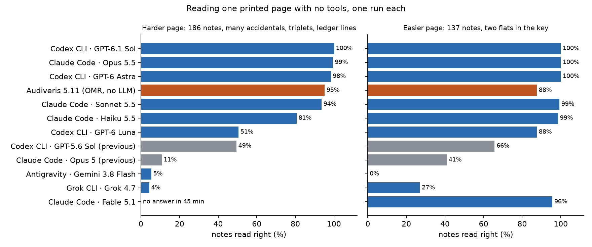
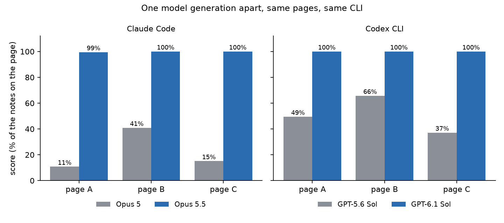
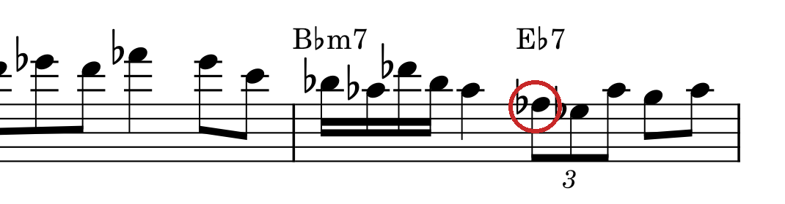
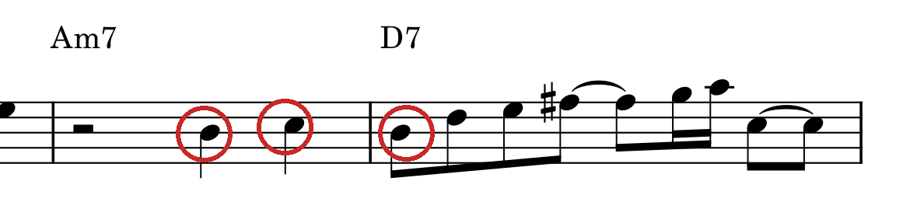
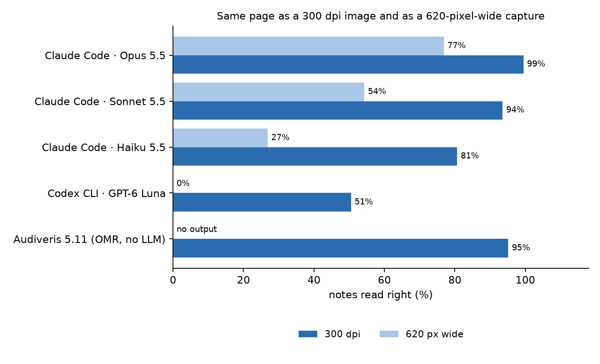
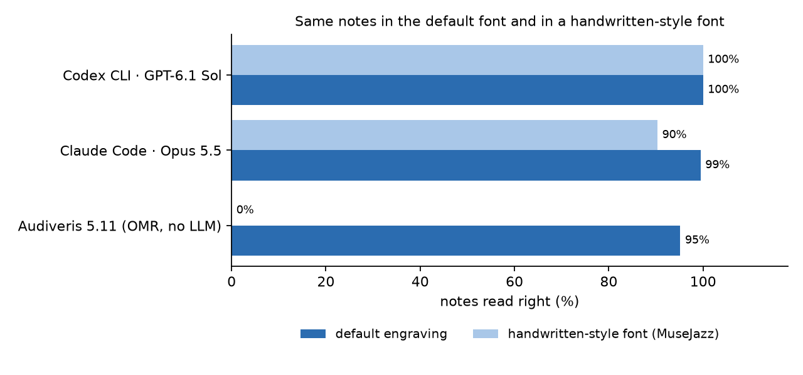

# Sheet-music reading went from 20% to 99.8% in one model generation

*Three generated pages, one run each: a small measurement, not a benchmark. Numbers are from 12 October 2026.*

I transcribe jazz solos into MuseScore with AI coding agents. Until this summer it went like this. An optical music recognition (OMR) program made a draft, and a model reviewed it. The model would write five or six beats into a four-beat bar, and cleaning that up cost me so much time that I added a rule to block it, along with other rules to keep the result musically sensible. Even then the model got notes wrong, and I went through each page myself and fixed it note by note.

One model generation later, there is far less for me to check. To make sure I was not fooling myself, I measured it on pages generated on the day of the test.

- On three generated pages (522 notes), Claude Opus 5 scored 20%. Opus 5.5, in the same CLI, scored 99.8%. GPT-5.6 Sol scored 49%; GPT-6.1 Sol scored 100%.
- Haiku 5.5, the smallest model in the current Claude family, scored far higher than Opus 5 on the two pages both read.
- On these pages the best current models, only looking at the image, scored higher than the OMR program I used to rely on.



## What I measured

If you don't read music: a bar is a short group of beats, a system is one row of music across the page, and the height of a note on the five lines gives its pitch.

**The pages.** A script generates each page from a random seed: one melodic line in 4/4 with chord symbols, 32 bars, in the style of a jazz line (scale runs, triplets, ties, rests, many sharps and flats). The pages were made for this test, after every model here was released, so none of them can have been memorised. MuseScore, a notation program, engraves the page. A second program then reads back the MusicXML file that MuseScore exports from the engraved score and compares it with the answer, including every accidental MuseScore chose to print. That check works on MuseScore's own description of what it drew, not on the pixels.

**The task.** The agent gets the page image and returns one line of text per bar: pitches, note values, ties, triplets and chord symbols. It may look at the image and do nothing else. Claude Code runs with only its file-reading tool. Codex CLI gets the image attached and a read-only sandbox. I checked the tool logs of every Claude Code and Codex run: one read of the image, or no tool use.

**The score.** A note is right when its position in the bar, its pitch and its length all match. Errors are counted as an edit distance per bar, so a wrong, missing or extra note costs one, and a skipped bar costs all its notes. The score for a page is the number of notes in the answer minus those errors, never below zero. For the weaker products this is lower than the count of notes they got right, because extra notes cost too. Pitches are worked out with the answer's key signature. Whether the agent named the key, the ties and the chord symbols are scored separately.

**The products.** A "product" is a model inside its vendor's CLI, at the reasoning effort I normally use (Claude Code: xhigh, with Haiku at the CLI default; Codex CLI: max). The results describe that pair, not the model alone.

Everything is one run per cell. Read small differences as noise.

## Results

Score out of the notes on the page:

| Product | Page A (186 notes) | Page B (137) | Page C (199) |
|---|---|---|---|
| Codex CLI · GPT-6.1 Sol | 186 | 137 | 199 |
| Claude Code · Opus 5.5 | 185 | 137 | 199 |
| Codex CLI · GPT-6 Astra | 183 | 137 | – |
| Claude Code · Sonnet 5.5 | 174 | 136 | – |
| Claude Code · Haiku 5.5 | 150 | 135 | – |
| Claude Code · Fable 5.1 | no answer in 45 min | 131 | – |
| Codex CLI · GPT-6 Luna | 94 | 120 | – |
| Codex CLI · GPT-5.6 Sol (previous generation) | 92 | 90 | 74 |
| Claude Code · Opus 5 (previous generation) | 20 | 56 | 30 |
| Grok CLI · Grok 4.7 | 8 | 37 | – |
| Antigravity · Gemini 3.8 Flash | 10 | 0 | – |
| Audiveris 5.11 (OMR, no language model) | 178 | 122 | 192 |

Pages A and C are the harder kind: no key signature, many accidentals, triplets, notes far above the staff. Page B has two flats in the key and simpler rhythm. A dash means I did not run that cell.

Audiveris lost its points to triplets that are not on the page, missed grace notes, and the last bar of each page, which it left out.

Gemini 3.8 Flash and Grok 4.7 are not those vendors' largest models, and they ran through wrapper scripts that give no tool log (see Limits).

### One generation apart



The gap shows on all three pages for both pairs. Model size alone does not explain it: Haiku 5.5 scored 81% and 99% on pages A and B, where Opus 5 scored 11% and 41%.

The previous-generation models read every chord symbol on all three pages, so plain text was not their problem. Their errors are in the notes.

### The errors that remain

In these runs the best models' remaining errors were single wrong pitches.



Opus 5.5 made one error on page A: it read the circled F♭ as D♭, a lower note. D♭ belongs to the chord printed above it (E♭7). F♭ does not.



GPT-6 Astra read these three notes one step low. Neither model marked these notes as uncertain, although the task asks for a `?` on anything it is unsure of.

### Low resolution still needs help



I shrank page A to a 620×877 JPEG. Opus 5.5 fell to 77%, and Audiveris exported nothing. The agents were not allowed to zoom here. In real work I let them crop and enlarge each system first.

### A handwritten-style font



To see whether the models had only learned one engraving style, I re-engraved pages A and B with MuseScore's MuseJazz style, which imitates handwriting. The notes are identical. GPT-6.1 Sol again scored 100% on both pages. Opus 5.5 dropped from 185 to 168 on page A and from 137 to 136 on page B. Audiveris got no bar right on either page.

This is a font, not handwriting. I did not test real handwritten scores.

## Why did it jump?

I don't know. Here is what the numbers allow.

- **Model size alone does not explain it.** Haiku 5.5 outscored Opus 5 by a wide margin.
- **Both pairs I tested moved.** Opus and Sol each jumped between consecutive versions. I did not test older Gemini or Grok models, so I cannot say whether those moved. The two I did test, Gemini 3.8 Flash and Grok 4.7, scored low.
- **GPT-6.1 Sol handled both engraving styles** I tried.
- **Earlier public tests point the same way**, on different material. A [blog post from May](https://www.artfish.ai/p/can-ai-read-music-part-2) found that Opus 4.7, GPT 5.4 and Gemini 3.0 Pro could not reliably name a single note. A [paper from July](https://arxiv.org/abs/2607.05769) found Gemini 3.1 Pro far behind a dedicated OMR model.

My guess is that music notation, or something close to it, became part of training or evaluation between these versions. Pages like mine are cheap to make in any quantity from symbolic music, which is all my generator does. A general gain in fine-grained vision would look the same from outside, though, and I did not separate the CLI's image handling, perception and reasoning. I found no release note that mentions any of it. If you know what changed, I would like to hear it.

## What this changes in how I work

Before, the model could not be trusted to read pitches. My notes from August say Gemini 3.7 Flash, reading a page on its own, got 62 of 138 pitches right on a page where the OMR program got all 138. So the OMR draft came first, the model repaired it bar by bar inside a harness of checks, and I proofread everything.

For a clean print, the measurement points to a simpler procedure:

1. Two models from different vendors read the page independently.
2. A program compares the two readings bar by bar.
3. A person looks only at the bars where they differ.

The steps, with the command for the comparison, are on [a separate page](workflow.md), together with what happened the one time I used it on a real transcription.

On page A, leaving the `?` marks aside, the readings of Opus 5.5 and Astra differ in three bars: 8, 27 and 28. Those are exactly the bars where one of them was wrong. Two readers can still share an error, so agreement narrows the checking without proving anything.

A model's own `?` marks did not do this job. In the clean default-font runs, Opus 5.5, Astra and Haiku 5.5 left their wrong notes unmarked, and Sonnet 5.5 marked two of its four wrong bars on page A. The marks were better on harder input: on the low-resolution page Opus 5.5 marked 11 of its 13 wrong bars.

The automatic checks stay: every bar must add up to the time signature, and the MusicXML must survive a round trip through MuseScore. OMR is still useful on a clean print as a cheap third reading.

For a low-resolution source, the first step is unchanged: crop each system and enlarge it before anyone reads it.

## Limits

- **Small.** Three pages in the default font, two in the handwritten-style font and one low-resolution page, each read once. There are no error bars, so small differences mean nothing.
- **One kind of music.** A single line with chord symbols in 4/4, generated and cleanly engraved. No piano music, no real handwriting, no scans of old editions.
- **Model plus CLI.** Each CLI handles images in its own way, and I used each vendor's usual effort setting. Gemini and Grok ran through wrapper scripts that give no tool log, so for those two I cannot show that the look-only rule was followed.

## Reproduce

```sh
git clone https://github.com/ui-hyo/sheet-music-reading-check && cd sheet-music-reading-check
uv venv && uv pip install pillow
PYTHONPATH=src .venv/bin/python -m sheetcheck.material --style solo --seed 4 --out material/solo-4   # a page nobody has seen
PYTHONPATH=src python3 -m sheetcheck.run --batch no-tools --pages solo-4 --inputs clean --products claude-code+opus-5.5
PYTHONPATH=src python3 -m sheetcheck.score material/solo-4/answer.txt results/no-tools/claude-code+opus-5.5/solo-4-clean.txt
```

Pages A, B and C are `material/solo-1`, `material/lead-3` and `material/solo-2`. Every reading and its score is under `results/`, and `results/no-tools/NOTES.json` lists what was not measured. The format is described in [FORMAT.md](https://github.com/ui-hyo/sheet-music-reading-check/blob/main/FORMAT.md).

---

*I built the tools and drafted this page with AI coding agents. The measurements are in the [repository](https://github.com/ui-hyo/sheet-music-reading-check) for anyone to check.*
