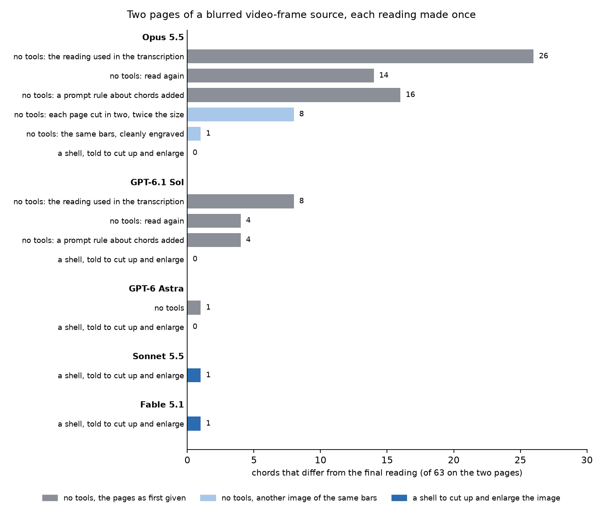

# Transcribing a page: two readings, then check only the listed bars

*The procedure that "What this changes in how I work" in the [write-up](index.md) points to. I have used it once on a real transcription, described under [One real use](#one-real-use). The examples and measurements outside that section use the readings stored in this repository. The commands cover what the measurement covered: one melodic line with chord symbols in 4/4.*

The aim is to stop proofreading every note. Two readers read the page independently, a program lists the bars that need a look, and a person checks those bars against the image.

## Steps

**1. Prepare the image.** A clean print rendered at 300 dpi can go to the readers as it is. A low-resolution source, such as a screen capture or a video frame, cannot: crop each system and enlarge it first, or give each reader the means to do so itself (see [One real use](#one-real-use)). In the measurement, Opus 5.5 scored 77% on a 620-pixel copy of a page where it otherwise had one wrong note.

**2. Get two readings.** Give each reader the image and [FORMAT.md](https://github.com/ui-hyo/sheet-music-reading-check/blob/main/FORMAT.md) as its only input: no OMR draft, and not the other reading. Let it use tools on that image, such as a shell with an image library to cut the page up and enlarge the pieces. What has to stay fixed is what the reader reads from, not how it looks. (The measurement in the write-up forbade tools on purpose, to see what the models read unaided. [One real use](#one-real-use) shows what that costs on a blurred source.) A second reading by the same model can repeat the first one's mistake, so the two readers are different models, from different vendors where possible. The format already asks for the two habits that matter here: write an accidental only where one is printed, and put `?` after anything you are unsure of.

**3. Compare them.**

```sh
PYTHONPATH=src python3 -m sheetcheck.compare opus.txt astra.txt
```

With the stored readings of page A by Opus 5.5 and GPT-6 Astra, this prints:

```
a  results/no-tools/claude-code+opus-5.5/solo-1-clean.txt
b  results/no-tools/codex-cli+gpt-6-astra/solo-1-clean.txt
key 0, time 4/4, 32 bars (m1 to m32)

4 bars to check: 7, 8, 27, 28

m7: marked unsure by a
  a  m7 | chords: 1=Fm7 | events: C6:8 D6:8 Eb6:8 D6:8 Fb6:q? E6:8 C6:8
  b  m7 | chords: 1=Fm7 | events: C6:8 D6:8 Eb6:8 D6:8 Fb6:q E6:8 C6:8

m8: notes differ at beat 3
  a  m8 | chords: 1=Bbm7 3=Eb7 | events: Bb5:16 Ab5:16 Db6:16 B5:16 A5:q {3 Db5:8 Eb5:8 A5:8} G5:8 A5:8
  b  m8 | chords: 1=Bbm7 3=Eb7 | events: Bb5:16 Ab5:16 Db6:16 B5:16 A5:q {3 Fb5:8 Eb5:8 A5:8} G5:8 A5:8
...
```

A bar is listed when the readings disagree on its notes, ties, rests or chord symbols, when a reader marked something in it with `?`, when it does not add up to the time signature, or when a reading has no usable line for it. Two spellings of the same pitch are not a difference. If the readers disagree on the key signature, the program says so and reads each one in its own key. Settle the key, then run again with `--key`.

Check the bar count in the header against the page. A bar that every reading leaves out at the end of the page cannot be listed.

**4. Check the listed bars.** Look at each listed bar in the image, enlarged, and correct the reading. A person can do this, or a model stronger than the two readers, given tools to enlarge the bar. In the example, bar 8 was Opus's error, bars 27 and 28 were Astra's, and in bar 7 both were right. The other 28 bars are left alone.

**5. Optionally add OMR as a third reading.** Audiveris exports MusicXML, and one command turns that into the same format:

```sh
audiveris -batch -transcribe -export -output omr -- page.png
PYTHONPATH=src python3 -m sheetcheck.musicxml omr/page.mxl > omr.txt     # the .mxl file Audiveris wrote under omr/
PYTHONPATH=src python3 -m sheetcheck.compare opus.txt astra.txt omr.txt --no-chords c
```

`--no-chords c` leaves the third reading out of the chord comparison, because these Audiveris exports contain no chord symbols.

It costs checking time. On pages A, B and C, adding the Audiveris reading to the pair of Opus 5.5 and GPT-6.1 Sol made the list grow from 2, 0 and 0 bars to 5, 4 and 3, and every added bar was an error of Audiveris. What it buys is a guard against two models making the same mistake: in both cases described below, Audiveris had the notes in that bar right, so a third reading would have put it on the list. This is for clean prints only. On the handwritten-style font Audiveris got no bar right, and on the low-resolution page it exported nothing.

A source that prints the same notes a second time can do this job instead. Guitar tablature did it for pitch in the [one real use](#one-real-use).

**6. Build the score and round-trip it.** An agent writes MusicXML from the corrected reading and MuseScore converts it. Then export MusicXML again from the MuseScore file and compare it with the reading:

```sh
mscore4 -o tune.mscz tune.musicxml
mscore4 -o roundtrip.musicxml tune.mscz
PYTHONPATH=src python3 -m sheetcheck.musicxml roundtrip.musicxml > roundtrip.txt
PYTHONPATH=src python3 -m sheetcheck.compare final.txt roundtrip.txt     # expect: 0 bars to check
```

This finds what was lost or changed on the way into MuseScore, chord symbols included. It cannot find a misreading, because both sides come from the same reading. This repository has no converter from a reading to MusicXML (its writer serves the generated test pages only). In my own work an agent writes that script for each tune. As a last step the agent compares each rendered system with the same system in the source.

## How much does comparing catch?

On the stored readings of the three default-font pages, I paired each current Claude model with each current Codex model: 22 pairs. In every pair, every bar that either reader had wrong was on the list. (`tests/test_compare.py` checks this.)

That is 22 pairs on three pages, not a guarantee. These stored readings also contain bars that two readers got wrong in the same way, and there the comparison shows nothing. Fable 5.1 and Opus 5 both read the F in bar 12 of page B as a D. Opus 5 and GPT-5.6 Sol both read the B in bar 27 of page A as an A, and those two are from different vendors.

A reader's own `?` marks do not replace the second reading. In the clean default-font runs, Opus 5.5 and Astra left their wrong notes unmarked (details in the [write-up](index.md)).

## One real use

After the measurement I used the procedure once on a real transcription: a jazz guitar part of 468 bars with single lines and chords, engraved, with a tablature staff under the notation. The source was a set of frames from a scrolling score video. An agent joined the frames, cut them at the barlines and laid them out again as pages of up to 32 bars: 358 written bars, two of them long rests that written out make the 468. Opus 5.5 and GPT-6.1 Sol each read every page once, and read the tablature in a separate pass.

**Readers with tools matched the final reading.** Step 1 had been skipped: the pages kept the small, blurred scale of the video frames, and the readers could only look. The comparison listed 161 of the 358 bars, where the generated pages had given the same pair 2, 0 and 0. Among the chords that could be compared with the final reading, Opus 5.5 differed on 68 of 191 and Sol on 15. The next day two of the pages were read again under several conditions. In this two-page test, each of the five models given a shell, and told to cut the image up and enlarge it, matched the final reading on 62 or 63 of the 63 chords.



Each bar is one reading of the two pages. The shell readings changed the instruction, the enlargement and the tools together, so the test does not say which of them mattered. The other ten pages were not read again. Fable 5.1 without tools finished one page only, with 29 of its 42 chords wrong, and is not drawn.

**A second source for pitch caught what two readers shared.** The same two models read the tablature separately, and a script worked out each pitch from its string and fret. In 115 bars the notation readings differed in their notes. The tablature settled 112 of them, and an agent settled the last three from the enlarged source. In five bars under an 8va line both models had written 20 notes an octave too low, in the same way. Three of those bars were not on the list, and only the tablature showed them.

**Rhythm had no second source.** This tablature prints no rhythm, so note values and ties rest on the two readings, which disagreed in eight bars. Audiveris could not be a third reading: on the three pages that were checked it found 8 or 9 bars where the page has 32. Nobody compared the result with the recording note by note. I listened to it against the recording, with the transcription laid over the audio and the score following along. It seemed almost perfect to me. That is an impression from listening, not a check.

**The agent did the checking, not I.** Its scripts settled the bars. The page layout, the tablature comparison and the MusicXML builder were written for this tune and are not in this repository. The round trip of step 6 needed allowances as well: as it stands it lists 34 of the 468 bars, 32 of them because the exported file spells a chord symbol in another way (`G7alt` comes back as `G7b5#5b9#9`). The agent's verifier reports no difference after allowing for chord spelling, chord placement and ties on only some notes of a chord.

## Limits

- **Used once on a real transcription.** One tune, one look-only notation reading of each page by each model. Cutting and enlarging were allowed only in the later test on two of its pages. The measurements outside "One real use" come from the generated pages.
- **Which readers.** The pairs measured here are current Claude and Codex models, and the one real use paired Opus 5.5 with GPT-6.1 Sol. The procedure has not been tried with weaker readers. On the same generated pages the previous-generation models scored 20% and 49%.
- **One line in 4/4** is what was tested. A pickup bar, or any other bar whose length differs from the time signature in the header, is listed as a bar that does not add up. That is a prompt to look, not an error.
- **Not tested:** real handwriting, piano music, more than one voice.
- **The comparison narrows the checking.** It does not prove the unlisted bars are right.
